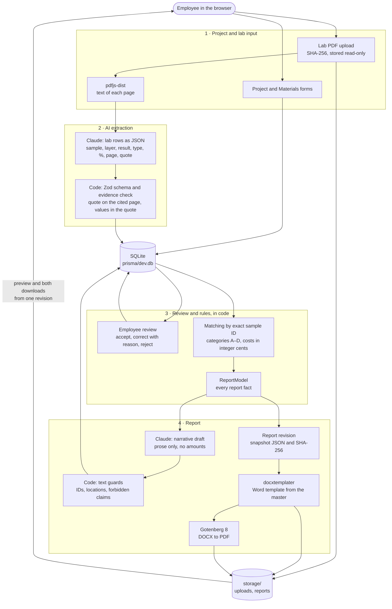

# ORTAM Asbestos Report App

Employee-facing prototype for the ORTAM asbestos report exercise. The employee enters a project and its material
zones, uploads the lab report PDFs, and an AI model extracts the sample and layer results with evidence (file, page,
quoted text). The employee reviews and corrects the results; the app matches them to zones by exact sample ID, applies
the exercise categories A–D and computes the fictional cost scenario in code. It then drafts the report narrative,
exports Word (built from the supplied Word master) and PDF (converted by Gotenberg) from one report revision, and
previews that exact PDF.

The source of truth is `fixtures/START_HERE_candidate_brief.pdf` together with `fixtures/fictional_rates_and_rules.pdf`.
All buildings, samples, results and prices are fictional.

- Handover note: [HANDOVER.md](HANDOVER.md)
- What is submitted: [docs/SUBMISSION.md](docs/SUBMISSION.md)

## Prerequisites

| Tool | Version | Notes |
|---|---|---|
| Node.js | **25.2.1** (npm 11.21.1) was used for development and for the clean-clone check | `engines.node` is `>=22.18.0`: the seed and the scripts run on Node's built-in TypeScript support, which older versions lack (D-003 in [docs/DECISIONS.md](docs/DECISIONS.md)). Other versions ≥ 22.18 were not tested. |
| Docker | Docker 29.6.2 with Compose v5.3.1 was used | Runs Gotenberg (DOCX → PDF). The image `gotenberg/gotenberg:8.38.1` is about 2.5 GB; the first `docker compose up -d` downloads it. |
| Anthropic API key | `sk-ant-…` | Used for lab PDF extraction and the narrative draft. Without it the app still runs, but those two steps fail with an error and a Retry button. |

Ports: the app uses **3000**, Gotenberg **3001** (bound to `127.0.0.1` only).

## Setup from scratch

```bash
git clone https://github.com/StanislavRakitianskiy/ortam-asbestos-app.git
```

```bash
cd ortam-asbestos-app
```

1. Create your local settings file, then open it and set `ANTHROPIC_API_KEY`:

   ```bash
   cp .env.example .env.local
   ```

   The other values work as they are: `ANTHROPIC_MODEL=claude-sonnet-5-5`, `GOTENBERG_URL=http://localhost:3001`,
   `DATABASE_URL="file:./dev.db"` (Prisma resolves it to `prisma/dev.db`) and `STORAGE_DIR=./storage`. `.env.local` is
   gitignored; never commit it.

2. Start Gotenberg:

   ```bash
   docker compose up -d
   ```

   `docker compose ps` shows the container as `healthy` after about 20 seconds.

3. Install the dependencies, generate the Prisma client and create the SQLite database:

   ```bash
   npm run setup
   ```

   This runs `npm ci`, `prisma generate` and `prisma migrate deploy`.

4. Optional, development only: load the demo register so you do not have to type it in.

   ```bash
   npm run db:seed
   ```

   This creates `ORTAM-DEMO-001` (the project header and material zones M01–M07 from
   `fixtures/employee_field_notes.pdf`, **no lab results**) and `ORTAM-DEMO-001-EDGE` (the same register, for the
   edge-case fixture). Running it again deletes and recreates both projects, including their uploads, reviews and report
   revisions.

5. Start the app:

   ```bash
   npm run dev
   ```

   Open http://localhost:3000. The home page shows three checks: the database, the PDF converter and the Anthropic key.
   "Configured" for the key is a format check only; a wrong key shows up at the first AI call.

## Demo walk-through

All input files are in `fixtures/`. The expected end result is in the "Golden expectations" table of
[CLAUDE.md](CLAUDE.md): total before tax **CAD 32,808.00**.

1. **Project.** Open `ORTAM-DEMO-001` from the project list (after `npm run db:seed`). Without the seed: click
   **New project**, enter the header from `fixtures/employee_field_notes.pdf` on the **Project** tab (project ID, client,
   building, address, inspection date, scope, planned work, jurisdiction note) and save.
2. **Materials.** Check or enter the zones M01–M07 from the field notes. Several sample IDs go in as separate chips
   (M03: S03 and S07). M05 and M07 use "Unknown (not measured)" for the quantity; M07 is "Accessible: No" with no sample.
   Edit a zone and reload the page: every value is still there.
3. **Lab reports.** Drop `fixtures/LAB-A_fictional_lab_report.pdf`, `fixtures/LAB-B_fictional_lab_report.pdf` and
   `fixtures/LAB-C_fictional_lab_report.pdf` on "Drop lab report PDFs here". Each card shows the extraction status and,
   when done, the model, tokens and time, with **View raw AI response**. Extraction usually takes 5–15 seconds per file.
   Drop the same file again: the card says it was already imported and no duplicate findings are created.
4. **Review → Lab results.** For each report, check every row against the quoted line highlighted on the PDF page in the
   source panel. Accept rows one by one or with **Accept all verified**; correct a value (a reason is required and
   logged) or reject a row.
5. **Review → Matching.** Every zone shows its status, category and cost line, plus the cost scenario. Blocking items
   (unknown, duplicate or conflicting sample IDs, unreviewed reports) must be resolved or kept flagged with a note
   (**Keep flagged**). Warnings such as M05's unknown quantity or M06 and M07 being unresolved need no decision and go
   into the report's limitations. With LAB-A/B/C accepted, the demo project has no blocking items.
6. **Report → Draft.** Click **Draft narrative with AI**, then read and edit the drafted texts and recommendations.
   Guardrail warnings appear beside a text (for example a zone text that does not name its location). Fill in the
   **Final review** checklist.
7. **Report → Preview and downloads.** Click **Generate report**. The preview shows the PDF of revision N; download it
   with **Download Word (rev N)** and **Download PDF (rev N)**. Change anything that the report prints (for example
   M05's quantity) and the preview turns "Outdated" and both buttons are disabled until you click **Regenerate**.
8. **Golden check.** Run `npm run verify` (see below); it reads `prisma/dev.db` and the stored revision files.

Edge cases: open `ORTAM-DEMO-001-EDGE` and upload LAB-A, LAB-B, LAB-C and the candidate-made
`fixtures/test/LAB-X_edge_cases.pdf`. Review → Matching then shows sample "S7" as unmatched (with the text hint
"Similar ID in register: S07", never linked automatically) and a conflicting result for S04. Correct S7 → S07 with a
reason and that issue clears.

## Tests and the golden check

```bash
npm test
```

Runs the Vitest suite once. It needs neither Docker nor an API key: AI answers are recorded real answers from
`tests/fixtures/ai/` (plus hand-written and tampered ones, labelled as such), and the PDF converter is faked. Service
tests use a throwaway SQLite file, never `prisma/dev.db`.

```bash
GOTENBERG_IT=1 npm test
```

Also runs the real DOCX → PDF conversion test against the running Gotenberg.

```bash
npm run typecheck
```

```bash
npm run lint
```

```bash
npm run verify
```

Golden check of `ORTAM-DEMO-001` in `prisma/dev.db`: zone statuses, categories, costs and totals against the table in
`CLAUDE.md`, and that the latest ready revision's Word and PDF print the same revision, snapshot and total (D-043). It
needs LAB-A/B/C accepted and a generated report, and exits with code 1 on any difference.

### All commands

| Command | What it does |
|---|---|
| `docker compose up -d` | Starts Gotenberg on http://localhost:3001. |
| `npm run setup` | `npm ci`, `prisma generate` and `prisma migrate deploy` (creates or updates `prisma/dev.db`). |
| `npm run dev` | Next.js development server on http://localhost:3000. |
| `npm run build` / `npm run start` | Production build and server. |
| `npm test` / `npm run test:watch` | Vitest once / in watch mode. |
| `npm run typecheck` | `next typegen`, then strict `tsc --noEmit`. |
| `npm run lint` | ESLint. |
| `npm run db:migrate` | `prisma migrate dev`, for schema changes during development. |
| `npm run db:seed` | Development-only demo data: `ORTAM-DEMO-001` and `ORTAM-DEMO-001-EDGE`, no lab results. |
| `npm run fixture:edge` | Regenerates `fixtures/test/LAB-X_edge_cases.pdf` (byte-for-byte reproducible). |
| `npm run template:build` | Rebuilds `templates/report_template.docx` from `fixtures/master_asbestos_report.docx`. |
| `npm run verify` | Golden check described above. |

## Architecture

One Next.js (App Router) application holds the UI and the server. Route handlers validate input with Zod and call a
service; services do the I/O; the rules are pure functions in `src/domain/`. Data lives in SQLite through Prisma,
files under `storage/`. Gotenberg (LibreOffice in Docker) converts the generated Word file to PDF.



The analysis and the report model are computed on every read (D-027, D-032), so a changed quantity or correction is
reflected at once. Generating a report hashes a snapshot of the report model, the template and the renderer version;
the DOCX and the PDF are rendered from that stored snapshot. When the current data no longer gives the same hash, the
preview is marked outdated (D-039).

### Where AI is used, and where code decides

AI is used for exactly two things. Everything else is deterministic code or the employee's decision.

| Step | Done by | Where |
|---|---|---|
| Text of each PDF page | Code (pdfjs-dist) | `src/server/pdf/extractPages.ts` |
| Lab rows: sample ID, layer, result label, asbestos type, percentage, page, quoted line | **AI** (Claude, JSON schema output) | `src/server/ai/extractLabReport.ts`, prompt `src/server/ai/prompts/labExtraction.v2.ts` |
| Shape of the answer, quote present on the cited page, values present in the quote | Code | `src/server/ai/labExtractionSchema.ts`, `verifyExtraction.ts` |
| Accept, correct (with a reason) or reject each row | Employee | `src/server/services/labReviewService.ts` |
| Matching by exact sample ID (trim + uppercase), unknown / duplicate / conflicting IDs | Code | `src/domain/sampleId.ts`, `matching.ts` |
| Zone status and category A–D | Code | `src/domain/categories.ts` |
| Rates, line amounts, allowances, contingency, totals, exclusions | Code | `src/domain/rates.ts`, `costs.ts` |
| Report structure, the facts paragraph of the summary, limitations, disclaimers | Code | `src/domain/reportModel.ts`, `reportText.ts` |
| Narrative prose: executive summary, per-zone interpretation, reason, uncertainty, follow-up, recommendation, limitations text | **AI draft**, edited by the employee | `src/server/ai/draftNarrative.ts`, prompt `prompts/narrative.v1.ts` |
| Narrative guardrails (zone and sample IDs, locations, categories, numbers, asbestos-free / compliance / clearance claims) | Code | `src/domain/textGuards.ts` |
| Word file and PDF | Code + Gotenberg | `src/server/report/renderDocx.ts`, `gotenberg.ts` |

The narrative model sees only `narrativeFacts`: zones, layers, report IDs and pages, the computed categories and their
reasons, missing information and limitations. It gets no money amounts, no names and no PDF text (D-033). Every model
call is stored as an `AiRun` with the model that answered, tokens, duration, prompt version and the raw answer.

## Folder structure

```text
.
├── src/
│   ├── domain/        Pure TypeScript, no I/O: types, rates, sample IDs, matching, categories, costs,
│   │                  report model, text guards, formatting. Fully unit-tested.
│   ├── server/
│   │   ├── ai/        Anthropic calls, schemas, evidence check, error messages; prompts/ holds versioned prompts
│   │   ├── pdf/       Text per page with pdfjs-dist
│   │   ├── report/    DOCX rendering, Gotenberg client, snapshot
│   │   ├── services/  Project, lab document, review, analysis, narrative, report, revision, health
│   │   ├── storage/   Upload and report file storage
│   │   └── env.ts, db.ts, http.ts, errors.ts
│   ├── app/           Pages and src/app/api route handlers (thin: Zod-validate, call a service)
│   ├── components/    UI: projects, lab-reports, review, matching, report, ui (shadcn)
│   └── lib/           Shared helpers: API client, dates, PDF line building (server check and viewer highlight)
├── prisma/            schema.prisma, migrations/, seed.mts (dev only). dev.db is gitignored.
├── templates/         report_template.docx, built from the master by npm run template:build
├── scripts/           build-template.ts, make-edge-fixture.ts, verify-golden.ts, ts-hooks.mjs
├── fixtures/          Supplied input files, read-only
│   └── test/          LAB-X_edge_cases.pdf, candidate-made test fixture
├── tests/             Vitest suites; tests/fixtures/ai/ holds recorded AI answers
├── docs/              ACCEPTANCE.md, DECISIONS.md, DATA_MODEL.md, SUBMISSION.md
├── submission/        The generated Word report and its matching PDF
└── storage/           Runtime files, gitignored: uploads/ (lab PDFs by SHA-256), reports/ (one folder per revision)
```

## Troubleshooting

**Port 3001 is already in use.** `docker compose up -d` fails with "address already in use" or "port is already
allocated". Find the process:

```bash
lsof -nP -iTCP:3001 -sTCP:LISTEN
```

Stop it, or publish Gotenberg on another port: change `127.0.0.1:3001:3000` in `docker-compose.yml` (for example to
`127.0.0.1:3011:3000`), set `GOTENBERG_URL=http://localhost:3011` in `.env.local` and restart `npm run dev`.

**Port 3000 is already in use.** `npm run dev` stops with "Failed to start server" and `EADDRINUSE`. Stop the other
process, or start the app on another port and open that one:

```bash
npm run dev -- --port 3005
```

The port is fixed on purpose: without it Next.js would move to 3001 and answer the app's own requests to Gotenberg
(D-045).

**Gotenberg is not running.** The home page shows "Cannot reach Gotenberg at http://localhost:3001/health", and
Generate report fails with "PDF converter is not running — start it with docker compose up -d". The failed attempt is
stored as a failed revision without files; nothing looks finished. Start Docker Desktop, then:

```bash
docker compose up -d
```

```bash
docker compose ps
```

Wait until the container is `healthy` (`curl http://localhost:3001/health` answers `"status":"up"`), then click
**Retry**.

**HTTP 401 from Anthropic.** The lab card or the draft shows "The Anthropic API rejected the API key (HTTP 401). Check
ANTHROPIC_API_KEY in .env.local and restart the server (npm run dev)." Put a valid key in `.env.local` (no quotes or
spaces needed), stop and restart `npm run dev` (the environment is read once per server process), then click
**Retry**. A 403 means the key cannot use the model; a "model not available" message means `ANTHROPIC_MODEL` is wrong.
The key is never logged or stored; anything shaped like a key is redacted from stored errors.

**Other.**

- `npm run setup` or `npm run db:seed` fails on syntax: check `node --version` is at least 22.18.
- `npm run verify` says there is no revision: generate the report in the app first.
- Start over with an empty database: stop the dev server, delete `prisma/dev.db` and the `storage/` folder, and run
  `npm run setup` again.

## Further documentation

- [HANDOVER.md](HANDOVER.md): time, AI tools, own checks, unfinished work, limitations, next steps.
- [docs/ACCEPTANCE.md](docs/ACCEPTANCE.md): the brief's completion checklist and case details, item by item, with where
  each is implemented and how to verify it.
- [docs/DECISIONS.md](docs/DECISIONS.md): short records of non-obvious choices (D-001 onwards).
- [docs/DATA_MODEL.md](docs/DATA_MODEL.md): the SQLite tables and their columns.
- [docs/SUBMISSION.md](docs/SUBMISSION.md): the list of submitted files.
- [CLAUDE.md](CLAUDE.md): domain rules and the golden expectations for the demo data.
